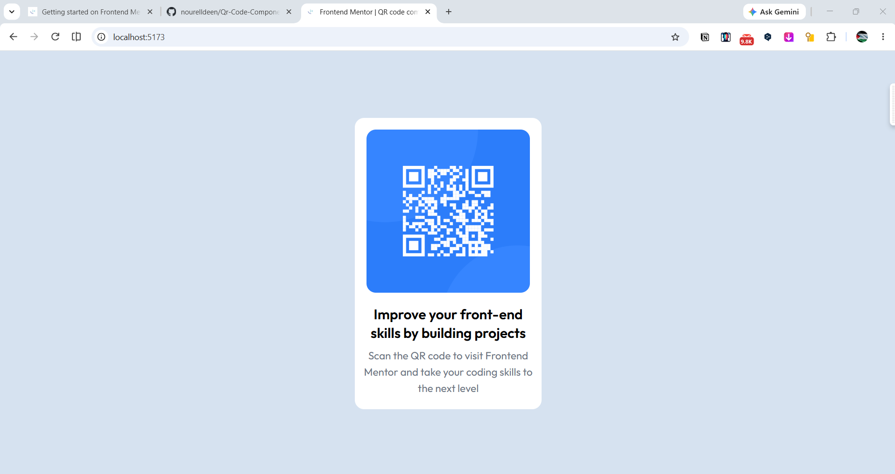
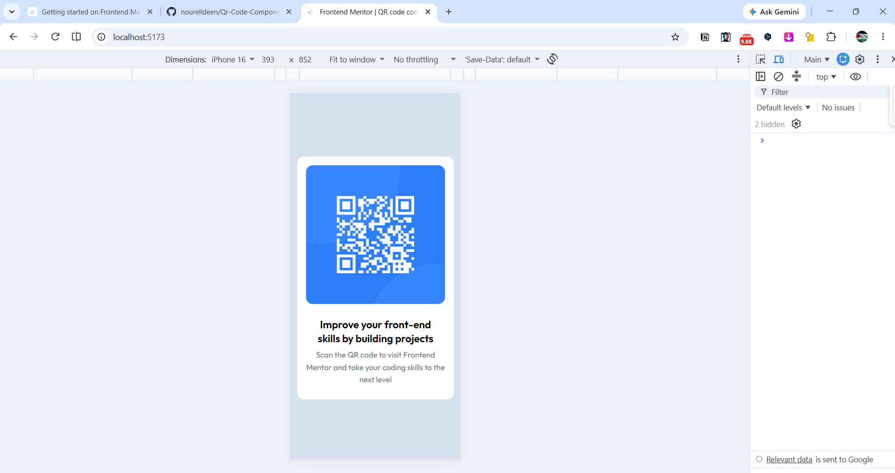

# Frontend Mentor - QR code component solution

This is a solution to the [QR code component challenge on Frontend Mentor](https://www.frontendmentor.io/challenges/qr-code-component-iux_sIO_H). Frontend Mentor challenges help you improve your coding skills by building realistic projects. 

## Table of contents

- [Frontend Mentor - QR code component solution](#frontend-mentor---qr-code-component-solution)
  - [Table of contents](#table-of-contents)
  - [Overview](#overview)
    - [Screenshot](#screenshot)
    - [Links](#links)
  - [My process](#my-process)
    - [Built with](#built-with)
    - [Process I followed](#process-i-followed)
  - [Author](#author)

## Overview

### Screenshot

### Links

- Solution URL: [GitHub repository](https://github.com/nourelldeen/Qr-Code-Component)
- Live Site URL: [QR code component](https://nourelldeen.github.io/Qr-Code-Component/)

## My process

### Built with

- Semantic HTML5 markup
- Tailwind CSS
- Flexbox
- Responsive design with Tailwind breakpoints
- Vite
- Google Fonts (Outfit)

### Process I followed

1. I reviewed the challenge design and style guide to identify the layout, colors, and typography.
2. I created the page structure in HTML with sections for the QR code image, heading, and description.
3. I used Tailwind utility classes and Flexbox to center the card and arrange its content.
4. I added responsive sizing with Tailwind's `md:` breakpoint utilities.
5. I loaded the Outfit font from Google Fonts and configured it in Tailwind.
6. I ran the project with Vite and adjusted the page while checking it in the browser.

## Author

- Website - [Nour Eldeen Sayied](https://www.your-site.com)
- Frontend Mentor - [@nourelldeen](https://www.frontendmentor.io/profile/yourusername)
- LinkedIn - [Nour Eldeen Sayied](https://www.linkedin.com/in/nour-eldeen-sayied/)
